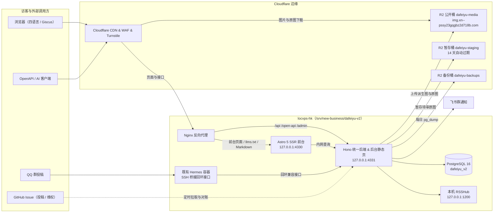

# 蓝色大肥鱼 v2 架构与重构方案

文档状态：已确认决策基线（2026-11-27）。后续开发、数据迁移、接口联调与上线验收均以本文为准。变更方案时，先更新本文再改代码。

## 1. 背景与决策基线

### 1.1 现状实测数据

截至 2026-11-27，线上旧站（版本 `73936aa`）与相关基础设施的实测状态如下：

| 项目 | 当前实测值 | 主要瓶颈 |
| --- | --- | --- |
| 公开图片作品 | 2,157 件（24 角色、6 类型、8 专题、1 连载） | 纯静态生成 11,024 个四语言 HTML 与 4,882 个 OpenAPI 文件，基线需校验 24,920 个文件，0 变更增量构建仍需 83.3 秒 |
| 公开视频与作者 | 331 个视频、21 位 B 站作者 | 与图片共用 6 小时发布窗口，上线延迟长 |
| 图片仓体积 | `dist/` 4.52 GB（6,130 文件），`.git/` 4.58 GB | Git 仓膨胀严重，需维护稀疏检出、原图释放回退 GitHub Raw 与上游改名映射 |
| 线上服务器 | `locvps-hk`，2 核 / 5.8 GiB 内存（空闲 4.6 GiB） | 旧站占 8.5 GB 磁盘；`/srv/new-business` 有 19 GB 空闲独立挂载盘可用 |
| Cloudflare R2 | 已有 3 个 `triview-*` 桶，已用 2.80 GB / 10 GB | 剩余 7.20 GB 免费额度，可完整容纳大肥鱼 4.52 GB 媒体资源 |
| 后台与后端 | Payload CMS 3 + `server/` JSON 队列 + `ops/` 执行器 | 服务割裂，数据库与 Git 双轨真源，Payload 构建需 8 GB 内存 |

### 1.2 已拍板的核心决策

| 编号 | 决策项 | 确认结论 |
| --- | --- | --- |
| D1 | 架构形态 | Astro 5 SSR 前台 + Hono 统一后端 + React 轻量自研后台 + PostgreSQL + Drizzle ORM + Cloudflare R2 |
| D2 | 隔离开发与部署 | 本机新建 `E:\quick-site-studio\bluedafeiyu-v2`；服务器部署至 `/srv/new-business/dafeiyu-v2`，测试子域 `v2.xn--pssy23gqgbz2d718b.com`，验收通过后再切主域 |
| D3 | 媒体存储 | 原图、缩略图、展示图、立绘、头像、OG 图全量迁入 R2 公开桶；站内下载与 OpenAPI v1 下载共用 R2 自定义域直链 |
| D4 | 保留能力 | 4 语言（简中、繁中、英语、日语）、B 站作者登记与视频同步、连载漫画、Hermes 审稿、Giscus 评论（沿用 `sticker-<id>`）、OpenAPI v1、AI Markdown（`llms.txt`）、网页/ZIP/QQ/GitHub Issue 投稿、飞书通知 |
| D5 | 精简项 | 取消收藏功能（移除收藏页与本地收藏存储），不引入访客账号体系 |
| D6 | 上线机制 | Hermes 审核通过且英日三语齐全后自动实时上线，同步发送飞书通知；站长在后台可随时一键秒隐藏或删除 |
| D7 | Hermes 复用 | 暂不改造线上 `hermes-webui` 容器，新后端保持原有 5 个回环接口与 QQ 入站协议兼容 |
| D8 | UI 与品牌 | 沿用三视库（`D:\Codex\Projects\triview`）的工作台画廊布局骨架与交互元素，配色改为蓝白主调，Brand Mark 与全套线性图标重新设计 |

### 1.3 上线红线

与 `AGENTS.md` 的「不可变契约」使用同一编号。

7. **老站图片路径零 404**。仍公开的图片必须在原路径返回 `200`，或以 `301` 永久重定向至可访问的新 R2 公开地址。严禁上线后出现老图片 `404`。

---

## 2. 系统架构与部署拓扑

### 2.1 组件关系



### 2.2 仓库目录规划

本仓库采用 pnpm workspace 单仓结构，共享类型与校验规则只维护一份。

v2 代码推送到原仓库 `lmy414/bluedafeiyu` 的独立 `v2` 分支。远端地址为 `git@github-lmy414:lmy414/bluedafeiyu.git`。测试期固定从 `v2` 部署，v2 改动在验收切流前不得进入 `main`。

```text
bluedafeiyu-v2/
  package.json
  pnpm-workspace.yaml
  packages/
    shared/
      src/
        types/          作品、角色、专题、连载、视频、投稿、OpenAPI 共享类型
        validation/     Zod 校验规则、URL 白名单、三语完整性校验
        design/         蓝白主题 CSS 变量与全套 1.45 px SVG 图标定义
  apps/
    api/
      src/
        db/             Drizzle Schema、迁移文件、种子与连接池
        routes/
          public/       前台分页、筛选、搜索、详情、投稿、视频登记、OpenAPI v1
          admin/        后台鉴权与管理接口（作品、审核、专题、连载、视频、维权、审计）
          hermes/       Hermes 5 个兼容回环端点与 QQ 入站适配器
        services/       sharp 图片处理、R2 客户端、CF 缓存清理、实时发布、飞书外发箱
        jobs/           B 站视频同步、GitHub Issue 拉取与对账、数据库 R2 备份
    web/
      src/
        layouts/        BaseLayout（Rail + Topbar + TabsBar + Footer）
        components/     蓝白工作台画廊组件、瀑布流、看图台、连载阅读器、Giscus
        i18n/           zh-CN / zh-TW（OpenCC 转换）/ en / ja 词典与路由辅助
        pages/          四语言路由、OpenAPI 转发/直出、llms.txt 与 Markdown 归档、Sitemap
    admin/
      src/
        pages/          总览、审核队列、作品库、角色与分类、专题与连载、视频与作者、维权申请、日志
        components/     共享蓝白表格、批量编辑器、拖拽排序、快捷预览
  scripts/
    migrate-r2.ts       离线将 AI娘表情包 与历史原图同步至 R2 并核验 SHA-256
    import-data.ts      将旧站 data/*.json 与 Payload SQLite 无损导入 PostgreSQL
    verify-parity.ts    核验旧站与 v2 路由、ID、slug、译文与图片可访问性
  ops/
    nginx/              v2 测试域与主域切流 Nginx 配置
    systemd/            dafeiyu-v2-api.service、dafeiyu-v2-web.service 与定时任务单元
  docs/
    架构与重构方案.md
```

### 2.3 服务器运行边界与缓存策略

- **端口分配**（全部仅绑定 `127.0.0.1`，不暴露公网端口）：
  - `127.0.0.1:4330`：`dafeiyu-v2-web.service`（Astro 5 SSR）
  - `127.0.0.1:4331`：`dafeiyu-v2-api.service`（Hono 后端 + `/admin` 静态后台）
  - `127.0.0.1:5432`：PostgreSQL 16（仅本地回环访问，数据目录位于 `/srv/new-business/dafeiyu-v2/pgdata`）
- **Cloudflare 缓存分层**：
  - `img.xn--pssy23gqgbz2d718b.com/*`（R2 公开桶）：`Cache-Control: public, max-age=31536000, immutable`。
  - 前台公开 HTML 页面与 Markdown 文档：`Cache-Control: public, max-age=60, s-maxage=300, stale-while-revalidate=600`。作品上线、编辑、隐藏或删除时，后端按路径异步调用 Cloudflare Cache Purge 清理对应详情页、首页和关联分组页。
  - `/open-api/v1/*`：`Cache-Control: public, max-age=60, s-maxage=180`，附带 `ETag` 与开放 CORS 头。
  - `/admin/*`、`/api/v1/submissions*`、`/api/v1/admin/*`：`Cache-Control: no-store`。

---

## 3. Cloudflare R2 存储与媒体规范

### 3.1 分桶规划与容量核算

账号当前 R2 已使用 2.80 GB（`triview-*` 三桶），免费额度余量 7.20 GB。大肥鱼现有 6,130 个媒体文件共 4.52 GB，迁入后总计约 7.32 GB，仍在每月 10 GB 免费线内。后续若超过 10 GB，超额存储单价为 $0.015 / GB / 月，出网流量永久免费。

| 桶名 | 访问级别 | 绑定域名 | 用途 | 生命周期策略 |
| --- | --- | --- | --- | --- |
| `dafeiyu-media` | 公开读 | `img.xn--pssy23gqgbz2d718b.com` | 已发布作品原图、缩略图、展示图、立绘、头像、OG 图 | 永久保留，仅下架删除时由后端主动删除 |
| `dafeiyu-staging` | 私有 | 无 | 待审核投稿原图、ZIP 解包临时文件、审核中中间产物 | 自动过期 14 天 |
| `dafeiyu-backups` | 私有 | 无 | PostgreSQL 每日压缩备份与公开数据快照 | 保留最近 30 天 |

### 3.2 对象键命名规范

所有公开作品媒体按原图 `sha256` 哈希寻址。修改作品标题、角色或分类时不移动对象，天然去重且可永久缓存。

```text
dafeiyu-media/
  originals/<sha256前2位>/<sha256>.<ext>     原图（保持原始格式与字节，含 GIF / PNG / JPG / WebP）
  thumbs/<sha256前2位>/<sha256>.webp         列表缩略图（宽 480 px，动图保留动画 WebP）
  display/<sha256前2位>/<sha256>.webp        看图台与详情展示图（宽上限 1600 px）
  og/works/<workId>.png                      按需生成并缓存的作品分享图
  assets/portraits/<characterId>.webp        角色透明立绘
  assets/avatars/creators/<creatorId>.webp   B 站作者头像
  assets/avatars/topics/<topicId>.webp       作者型专题头像
  assets/site/<name>.<ext>                   站点图标、二维码等固定资源

dafeiyu-staging/
  submissions/<submissionId>/<sha256>.<ext>  待审原图（审核通过后转码入公开桶再删除）
```

### 3.3 CORS、防刷与下载体验

1. **CORS 配置**：`dafeiyu-media` 放开匿名 `GET`、`HEAD` 跨域（`AllowedOrigins: ["*"]`，`AllowedMethods: ["GET", "HEAD"]`，`MaxAgeSeconds: 86400`），同时满足站内前端 ZIP 打包下载与外部 OpenAPI 网页调用。
2. **不封禁空 `Referer`**：OpenAPI 脚本与命令行客户端不携带 `Referer`。防滥用放在 Cloudflare WAF 做异常高频限速与 404 防扫，不破坏公开下载。
3. **友好下载文件名**：OpenAPI 直接返回 R2 不可变直链；站内点击“下载原图”时，前端按 CORS 拉取 Blob 或走轻量下载跳转附带 `<作品名>.<ext>` 文件名。
4. **下架与缓存清理**：
   - `hidden`（隐藏）：从前台列表与详情隐藏（详情页返回 404），保留 R2 原图以便随时恢复；如涉及隐私或版权争议，切换为 `removed` 并将公开桶对象迁至私有隔离前缀后清理 CF 缓存。
   - `deleted`（彻底删除）：删除 `dafeiyu-media` 对应原图与派生图并清理 CF 缓存，数据库保留 `sha256` 墓碑防止重复收录。

### 3.4 历史图片离线迁移流程

迁移脚本 `scripts/migrate-r2.ts` 在本机或服务器离线执行，不中断旧站：

1. 读取旧站 `data/works.json`、`data/blue-fish-classification.json`、`data/blue-fish-original-overrides.json`、`data/owner-picks.json`、`data/character-portraits.json` 与 `data/video-archive.json`。
2. 优先从本地 `AI娘表情包/` 读取原图与派生图；缺失原图时按核验后的上游路径或 GitHub Raw 拉取并校验 `sha256`。
3. 缺失缩略图/展示图或宽高元数据为 0 的历史记录，由 `sharp` 现场补齐派生图与真实像素宽高。
4. 以幂等 `HEAD` 检查并发上传至 `dafeiyu-media`，输出完整 `r2-migration-manifest.json`（含每条记录的 `workId`、`sha256`、三个 R2 Key、宽高与字节数），供数据导入脚本直接写入 PostgreSQL。

---

## 4. 数据库 Schema 设计（PostgreSQL + Drizzle）

采用单一 PostgreSQL 数据库 `dafeiyu_v2`，启用 `pg_trgm` 扩展支持中、英、日文子串模糊检索。

### 4.1 核心数据表清单

| 表名 | 职责 | 关键字段与约束 |
| --- | --- | --- |
| `characters` | 角色主档 | `id` (PK, slug), `name`, `aliases` (text[]), `description`, `i18n` (jsonb), `portrait_key`, `portrait_width`, `portrait_height`, `brand_tokens` (jsonb), `sort_order`, `status` |
| `categories` | 作品类型（固定 6 类） | `id` (PK: `meme` / `illustration` / `setting` / `comic` / `standing` / `other`), `name`, `description`, `i18n` (jsonb), `sort_order`, `status` |
| `works` | 图片作品主表 | `id` (PK, 冻结 `workId`), `slug` (UNIQUE, 冻结), `name`, `description`, `commentary`, `kind` (`submission`/`owner-picks`/`blue-fish`), `channel`, `submission_id`, `sha256` (UNIQUE), `primary_character_id` (FK), `category_id` (FK, 单选必填), `tags` (text[]), `r2_original_key`, `r2_thumb_key`, `r2_display_key`, `format`, `mime_type`, `is_animated`, `width`, `height`, `file_size`, `thumb_width`, `thumb_height`, `display_width`, `display_height`, `submitter` (jsonb), `origin` (jsonb), `license` (jsonb), `i18n` (jsonb: `{en, ja}`), `status` (`pending`/`published`/`hidden`/`removed`/`deleted`), `revision` (sha256 摘要), `view_count`, `download_count`, `published_at`, `created_at`, `updated_at` |
| `work_characters` | 作品与多角色关联表 | `work_id` (FK), `character_id` (FK), 联合主键 `(work_id, character_id)`，支持高效多角色筛选 |
| `topics` | 人工专题与连载漫画 | `id` (PK, kebab-case 冻结), `name`, `summary`, `cover_work_id` (FK), `is_serial` (boolean), `reader_config` (jsonb: `totalPages`, `credits`, `creditsI18n`), `author` (jsonb: `name`, `url`, `bio`, `channels[]`), `i18n` (jsonb), `status` (`draft`/`active`), `sort_order`, `created_at`, `updated_at` |
| `topic_works` | 专题/连载作品编排表 | `topic_id` (FK), `work_id` (FK), `position` (int, 展示顺序), `page_number` (int, 仅连载正文页有值，封面为空) |
| `submissions` | 统一投稿队列（合并原 `server/` 与后台） | `id` (PK, `sub_<hash>`), `source` (`web`/`github-issue`/`qq`/`manual`), `source_ids` (text[]), `sha256`, `r2_staging_key`, `fields` (jsonb), `editorial` (jsonb), `review` (jsonb), `agent_progress` (jsonb), `state` (`received`/`reviewing`/`auto_passed`/`auto_rejected`/`needs_manual`/`approved`/`rejected`/`published`), `state_history` (jsonb), `origin` (jsonb), `work_id` (FK, 可空), `created_at`, `updated_at` |
| `creators` | B 站登记作者 | `id` (PK, `bilibili-<uid>`), `uid` (UNIQUE), `homepage`, `name`, `avatar_key`, `intro`, `status` (`queued`/`active`/`paused`), `sync_page`, `sync_lease` (jsonb), `last_synced_at`, `retry_at`, `error`, `created_at`, `updated_at` |
| `videos` | B 站视频审核与归档 | `id` (PK), `bvid` (UNIQUE), `creator_id` (FK), `title`, `source` (jsonb), `status` (`queued`/`reviewing`/`approved`/`rejected`/`manual`/`hidden`), `review` (jsonb, 含角色与三语译文), `lease` (jsonb), `published_at`, `created_at`, `updated_at` |
| `takedown_requests` | 下架与署名/来源/授权更正申请 | `id` (PK, `github-rights-<issue>`), `request_type` (`takedown`/`attribution`/`source-correction`/`license-correction`), `work_id` (FK), `requester` (jsonb), `status`, `decision_note`, `issue_data` (jsonb), `agent_progress` (jsonb), `processed_at`, `created_at`, `updated_at` |
| `events` | 站内活动配置 | `id` (PK), `slug`, `title`, `summary`, `i18n` (jsonb), `payload` (jsonb), `status`, `starts_at`, `ends_at` |
| `friend_links` | 友情链接与社区项目 | `id` (PK), `kind` (`friend`/`project`), `name`, `url`, `description`, `avatar_key`, `i18n` (jsonb), `sort_order`, `status` |
| `admin_users` | 后台管理员与机器人凭证 | `id`, `email`, `password_hash`, `role` (`owner`/`bot`), `api_token_hash`, `last_login_at` |
| `bulk_jobs` | 后台异步批量任务（AI 补全/翻译等） | `id`, `kind`, `payload` (jsonb), `status`, `progress` (jsonb), `result` (jsonb), `created_at`, `updated_at` |
| `audit_events` | 操作审计日志 | `id`, `actor_type` (`owner`/`hermes`/`system`), `actor_id`, `entity_type`, `entity_id`, `action`, `diff` (jsonb), `created_at` |
| `notify_outbox` | 飞书通知可靠外发箱 | `id` (UUID 去重键), `event_type`, `payload` (jsonb), `status` (`pending`/`sent`/`failed`), `message_id`, `attempts`, `next_retry_at`, `created_at` |

### 4.2 关键索引与检索设计

- `works` 表建立：
  - 复合索引 `(status, published_at DESC, slug ASC)` 用于首页与图库默认倒序分页；
  - 索引 `(category_id, status)` 用于按作品类型筛选；
  - `GIN (tags)` 用于标签精确筛选；
  - `GIN` + `pg_trgm` 索引覆盖中文标题/说明/点评、标签及 `i18n` 英日文本，配合 `characters.aliases` 实现多语言毫秒级服务端搜索。
- **连载隔离规则**：查询普通首页、图库和角色作品流时，统一排除出现在 `topic_works` 中且所属 `topics.is_serial = true` 的作品；连载作品继续保留详情页地址、搜索结果与 OpenAPI 单件记录。
- **作品修订摘要（`revision`）**：每次修改公开字段时按确定性 JSON 计算 SHA-256 写入 `works.revision`，供 OpenAPI v1 增量同步和缓存校验使用。

### 4.3 历史数据无损导入规则

`scripts/import-data.ts` 按以下顺序导入并做全量断言：

1. 导入 `categories.json`、`characters.json`（合并 `character-portraits.json` 与角色主题变量）、`events.json`、`friend-links.json`。
2. 合并导入 `works.json`、首批 205 条（`blue-fish-classification.json` + `blue-fish-ids.json` + `blue-fish-editorial.json`）、`owner-picks.json` 与 `work-localizations.json`，关联 `r2-migration-manifest.json` 写入 R2 对象键与真实像素尺寸。将旧缩略图、展示图和原图路径分别写入 `works.origin.legacyPaths` 的 `thumb`、`display`、`original` 数组。路径以 `/` 开头，去重后入库。`revision` 仍按公开字段计算。
3. 导入 `topics.json` 与 `serial-topics.json`（连载专题标记 `is_serial = true` 并写入 `page_number`）。
4. 导入 `video-archive.json` 以及旧 Payload SQLite（`admin.db`）中的未完成 `submissions`、历史 `creators`/`videos`、`takedown_requests` 与墓碑记录。
5. 断言检查：已发布作品总数、冻结 `workId`/`slug` 集合、已发布视频总数、连载页码映射与旧站完全一致。

---

## 5. 统一后端、实时上线与 Hermes 兼容设计

### 5.1 统一 Hono 后端职责

原 `server/`（端口 8790/8788）、`admin/` 后端（端口 3100）和 `ops/admin/` 发布执行器合并为单一 `apps/api` 服务（监听 `127.0.0.1:4331`）：

- **公开业务接口（`/api/v1/*`）**：
  - `GET /api/v1/works`：支持 `lang`、`character`、`category`、`tag`、`topic`、`animated`、`q`、`sort`、`cursor`/`page` 服务端筛选与分页。
  - `GET /api/v1/works/:slugOrId`：作品详情与相邻推荐。
  - `POST /api/v1/submissions` 与 `POST /api/v1/submissions/zip`：网页单图与 ZIP 批量投稿，校验 Turnstile、Origin 白名单、IP 限流（10 次/小时）、图片魔数与 `sha256` 去重后，原图直传 `dafeiyu-staging` 并入库 `submissions`。
  - `POST /api/v1/creators`：B 站作者登记入口（沿用 Turnstile 与限流）。
- **OpenAPI v1（`/open-api/v1/*`）**：
  - 按 [原静态开放 API 契约](file:///E:/quick-site-studio/bluedafeiyu/docs/静态开放API.md) 保持全部路径与字段结构（`index.json`、`manifest.json`、`taxonomy.json`、`works.json`、`works/page/:n.json`、`works/:id.json`、各类分组与交集端点）。
  - `image.originalUrl`、`image.thumbnailUrl`、`image.displayUrl` 统一输出 `https://img.xn--pssy23gqgbz2d718b.com/...` 直链。
- **后台管理接口（`/api/v1/admin/*`）**：使用 HttpOnly Cookie 会话认证（Owner 角色），支持单条/批量改分类、改角色、隐藏/恢复/删除、专题与连载拖拽排序、人工收录与重审。

### 5.2 Hermes 100% 协议兼容层

为保证线上 `hermes-webui` 容器不改插件与技能即可切换，Hono 后端在回环接口上完整保留原有路径、鉴权头与返回结构：

| 既有接口 | 鉴权令牌 | v2 处理逻辑 |
| --- | --- | --- |
| `POST /api/v1/internal/agent` | `HERMES_REVIEW_TOKEN` | 接管投稿 `list`/`rules`/`claim`/`get`/`image`/`draft`/`locale`/`validate`/`complete`/`release`；`image` 从 `dafeiyu-staging` 读取原图返回 |
| `POST /cms-api/agent` | `ADMIN_WORKER_TOKEN` | 接管后台补全/翻译任务与专题维护 |
| `POST /cms-api/video-agent` | `ADMIN_WORKER_TOKEN` | 接管 B 站视频审核队列，审核通过且三语完整后直接上线并清缓存 |
| `POST /cms-api/request-agent` | `ADMIN_WORKER_TOKEN` | 接管署名/来源/授权更正与下架申请；通过后直接更新作品并写回 GitHub Issue 回复队列 |
| `POST /cms-api/submissions/sync` | `ADMIN_WORKER_TOKEN` | 因投稿与作品已合库，校验无误后直接返回 `{ status: "ok", errors: [] }` |
| `POST /api/v1/adapters/qq/events` | QQ 入站令牌 | 维持原 QQ 群 `@机器人 投稿` 协议与每小时 10 张限额 |
| `POST /cms-api/topics/upsert` | Owner / Bot API Key | 维持原严格白名单约束，仅允许机器人维护专题文案与作者元数据 |

切换时，宿主机 `dafeiyu-hermes-bridge` 环境文件中把 `HERMES_REVIEW_API_URL` 与后台回环地址指向 `http://127.0.0.1:4331` 即可。

### 5.3 自动实时上线与秒级撤回流程

当 Hermes 对某条投稿调用 `complete` 并给出通过结论时，后端在单次事务与编排中自动执行：

1. **严格校验**：检查主角色、单作品类型、中文标题/描述以及完整有效的 `en` 和 `ja` 译文；任何字段不合规直接返回 `422` 附字段路径，不入库上线。
2. **生成派生图并写入 R2 公开桶**：从 `dafeiyu-staging` 读取原图校验 `sha256`，使用 `sharp` 生成 `thumbs/` 与 `display/` WebP（动图保留动画）并读取真实像素尺寸；原图与两张派生图全部上传至 `dafeiyu-media`。
3. **落库并实时公开**：生成冻结 `workId`（`sticker_<sha256前24位>`）与冻结 `slug`，写入 `works` 与 `work_characters`（`status = 'published'`），同步更新 `submissions.state = 'published'`，删除 `dafeiyu-staging` 暂存原图。
4. **缓存失效与通知**：异步清理 Cloudflare 首页、对应角色/分类/OpenAPI 缓存，并通过 `notify_outbox` 向飞书群发送上线通知（附作品直链与后台快捷隐藏入口）。若来自 GitHub Issue，自动触发 Issue 回复并关闭。
5. **站长秒级隐藏**：若站长在飞书看到新图不满意，进入后台一键点“隐藏”或“删除”，数据库立刻更新并触发 CF 清缓存，10 秒内前台即不可见。

### 5.4 定时后台任务

原分散的 systemd timer 收拢为清晰的内置/独立轻量任务（由 `systemd` timer 触发调用 Hono 内部任务口或直接执行脚本）：

- **B 站作者与视频同步**（每分钟轮询 1 位到期作者，复用本机 `127.0.0.1:1200` RSSHub，发现新视频写入 `videos` 待 Hermes 审核，作者头像变更自动转存 R2）。
- **GitHub Issue 拉取与对账**（定时拉取投稿 Issue 与 `takedown` 申请 Issue，已上线或已拒绝的自动评论并关闭）。
- **飞书通知外发箱重试**（每分钟补发 `notify_outbox` 中失败消息）。
- **每日数据备份**（凌晨执行 `pg_dump | zstd` 上传至 `dafeiyu-backups`，可选按日导出脱敏公开 JSON 快照存档）。

---

## 6. 自研轻量 CMS 后台设计（`/admin`）

使用 React + Vite + TypeScript 构建静态单页应用，由 `apps/api` 托管在 `/admin`，完全替换 Payload CMS。界面沿用前台同一套蓝白工作台设计变量（支持暗色模式）。

| 模块 | 核心功能 |
| --- | --- |
| **总览仪表盘** | 今日/本周自动上线数、待审与待人工队列数、R2 媒体与数据库状态、最近飞书通知与错误告警、一键快捷隐藏最近上线作品 |
| **投稿与审核队列** | 按状态（`received` / `reviewing` / `needs_manual` / `auto_rejected` / `published`）与渠道（Web / QQ / GitHub）筛选，查看原图预览、AI 审核理由、Hermes 进度；支持人工编辑后直接收录上线、拒绝或提交重审/重译 |
| **作品库管理** | 服务端分页与多条件筛选；支持单条与批量修改分类、角色、标签、署名、来源、授权、三语译文；支持一键隐藏、恢复、移除（`removed`）与彻底删除（清 R2 留墓碑） |
| **角色与分类管理** | 维护 24+ 角色的名称、别名、三语、透明立绘上传（直传 R2）与角色主题配色变量 |
| **专题与连载编排** | 维护普通专题、作者型专题与连载漫画；支持从作品库搜索勾选、拖拽排序、指定封面、绑定连载原稿页码与缺页占位 |
| **B 站作者与视频** | 查看登记作者同步状态、暂停/恢复同步、处理失败重试；查看 AI 视频审核证据、手动下架已通过视频 |
| **下架与更正申请** | 查看 GitHub 维权 Issue 原文、Hermes 处理进度与决定；支持人工复核、执行更正或下架并回复关闭 Issue |
| **机器人与审计日志** | 管理 Bot API Key、查看 `bulk_jobs` 异步任务进度与全站 `audit_events` 操作记录 |

---

## 7. 前台 UI 架构与蓝白视觉系统

### 7.1 延续三视库签名布局骨架

完整继承 `D:\Codex\Projects\triview`（2026-11-27 版）的“工作台画廊”识别度：

- **左侧 64 px 图标 Rail（`rail-sidebar`）**：顶部放置新设计的蓝色大肥鱼 Brand Mark；主导航区为图库、角色、专题、连载、视频、GIF（桌面端带悬浮 Tooltip，移动端切换为侧滑抽屉）；底部分组放置语言切换（简/繁/英/日）、暗色模式切换与“更多页面”浮层（社群、关于、友链、开放 API、更新日志）。**不设收藏与账号入口**。
- **顶部 46 px 纤细顶栏（`topbar`）**：左侧为全局搜索框（支持 `/` 快捷键聚焦与清除），右侧为核心操作按钮（“站内投稿”主按钮与语言/快捷入口）。
- **49 px 二级 Tab / 面包屑栏（`sheet-tabs-bar`）**：首页与图库页展示横向分类 Tab（全部、梗图、插画、设定图、漫画、立绘、其他）与快捷角色筛选；内页显示单行面包屑；右侧固定放置等宽字体作品计数与排序选择。
- **字体与工艺细节**：`Inter` + `JetBrains Mono` + `Noto Sans SC`，数字启用 `tabular-nums`；控件统一 `6 px` 圆角与 `0.5 px` 细腻边框阴影；画框保留 `draft-corners` 精密角标与 `ruler-line` 标尺装饰。

### 7.2 蓝白主调设计变量（明 / 暗双主题）

保留三视库的克制对比度，将中性灰调演化为清晰辨识的晴空蓝白与深海蓝灰体系：

| 语义 Token | 亮色（晴空蓝白） | 暗色（深海蓝灰） | 用途 |
| --- | --- | --- | --- |
| `--bg` | `#f7faff` | `#0c121d` | 页面主画布 |
| `--panel` | `#eef4fc` | `#121a29` | Hero 面板、搜索框底色 |
| `--surface` | `#ffffff` | `#162033` | 卡片、按钮、弹层表面 |
| `--sidebar` | `#f3f7fe` | `#0f1624` | 左侧 64 px Rail |
| `--line` | `#dbe6f5` | `#24324a` | 1 px 细分割线与边框 |
| `--line-strong` | `#b8cce8` | `#394d6e` | 强调边框与悬浮边框 |
| `--ink` | `#0f1d36` | `#e8f0fc` | 主正文与标题 |
| `--muted` | `#4c6184` | `#9eb0cc` | 次级说明文字 |
| `--tert` | `#7d91b2` | `#6e82a3` | 辅助标尺与分隔符 |
| `--accent` | `#1d6ef5` | `#5aa2ff` | 肥鱼主蓝、激活态与焦点 |
| `--accent-dark` | `#1455c4` | `#84bbff` | 主按钮与链接悬浮态 |
| `--accent-soft` | `#e6f0ff` | `#1a2e4f` | 选中浅蓝底色与文本选区 |

角色档案页仅在内容区（`main`）覆盖 `--character-accent` 局部强调色，侧栏与顶栏维持全站统一蓝白配色。

### 7.3 全新 Brand Mark 与图标体系

- **Brand Mark**：摒弃旧位图缩放方式，设计一枚在 24 px～512 px 均可清晰辨识的极简几何“蓝色大肥鱼”矢量标志（用于 Rail 顶部、Favicon、Apple Touch Icon 与 OG 水印）。
- **统一线性图标**：重绘全站图标，固定 `viewBox="0 0 24 24"`、`stroke-width="1.45"`、圆角端点，覆盖图库、角色、专题、连载、视频、GIF、投稿、下载、复制、分享、语言、明暗切换、缩放、上一张/下一张与外部链接。

### 7.4 核心页面与交互体验

1. **首页与图库（零抖动瀑布流）**：
   - 首屏采用 1.35 : 1 : 1 三列 `home-hero`：左列放站点标题、简介与快速搜索，中列与右列展示精选专题/连载与最新推荐作品卡。
   - 瀑布流卡片严格使用数据库记录的真实 `thumb_width / thumb_height` 锁定占位比例，消除 CLS。卡片桌面端悬浮展示角色/类型角标与底部标题 + R2 一键原图下载按钮；移动端在图下方展示紧凑信息条。
   - 翻页采用服务端分页 + “加载更多”流式追加，不再下载全量目录 JSON。
2. **升级版 Lightbox 看图台 & 作品详情页**：
   - 列表点图直接打开看图台弹窗，支持键盘左右切图、滚轮缩放、透明/白/灰/深底切换（查看透明底立绘与表情包很实用）、来源与授权信息速览、一键原图下载与进入独立详情页。
   - 详情页保留稳定 `/works/<slug>.html`（同时对无 `.html` 路径做 301 跳转兼容），挂载 **Giscus 评论区（`data-term="sticker-<workId>"`）**、来源/授权声明、相关专题与同角色推荐。
3. **连载漫画阅读器**：延续独立 `/serials` 入口与 `/topics/<id>/page/<原稿页码>` 路由，支持无 JS 前后翻页与键盘快捷键，封面不占正文页码，缺页保留提示。
4. **四语言原生渲染**：URL 沿用 `/zh-hant/...`、`/en/...`、`/ja/...` 前缀结构（简中为根路径），Astro SSR 直接读取对应语言词典与数据库 `i18n` 渲染完整 HTML、canonical、`hreflang` 与 JSON-LD；繁体由服务端/词典层通过 OpenCC 稳定转换。
5. **AI 阅读入口与 SEO**：动态路由直出 `/llms.txt`、`/llms-full.txt` 与作品/角色/专题 Markdown 文档，配合动态 `sitemap.xml` 与 `robots.txt`。
6. **兼容路由清单**：旧站所有 `.html` 结尾路径（如 `/works/<slug>.html`、`/characters/<id>.html`、`/topics/<id>.html`、`/submit.html`、`/videos.html`、`/serials.html` 等）统一支持直出或 301 规范化，旧收藏路径 `/saved.html` 返回 301 至首页。

---

## 8. 分阶段施工计划与验收门禁

全程在 `E:\quick-site-studio\bluedafeiyu-v2` 开发，按 6 个阶段推进，每阶段完成后验证过关再进入下一阶段。

| 阶段 | 核心交付物 | 验收标准 |
| --- | --- | --- |
| **阶段 1：工程骨架与数据层** | 初始化 pnpm Monorepo、配置 Drizzle + PostgreSQL 16 Schema 与初始迁移、搭建 `packages/shared` 与蓝白基础变量 | 本地 PostgreSQL 迁移通过，Schema 单元测试全绿 |
| **阶段 2：R2 建桶与全量数据迁移** | 创建 `dafeiyu-media` / `dafeiyu-staging` / `dafeiyu-backups` 三桶并配好自定义域与 CORS；运行 `migrate-r2.ts` 与 `import-data.ts` | 2,157 件图片作品、331 个视频、24 角色、8 专题与连载全部无损入库；R2 对象 100% 校验通过、0 缺图、0 宽高为 0 |
| **阶段 3：Hono 统一后端与 Hermes 兼容层** | 实现公开查询/搜索 API、投稿（Web/ZIP/QQ）与 Turnstile 校验、OpenAPI v1、实时上线编排（sharp + R2 + CF Purge + 飞书通知）、Hermes 5 个兼容回环接口、B 站同步与 Issue 对账任务 | 接口集成测试全绿；使用测试投稿跑通“入队 → Hermes 工具领取/看图/写三语 → 自动上线 R2 → 飞书通知 → 秒级隐藏”完整流程 |
| **阶段 4：自研轻量 CMS 后台** | 完成 `/admin` 7 个工作台页面与管理员认证、审计日志 | 站长可在后台完成审核、批量改分类/角色、专题与连载拖拽编排、视频与维权申请处理、一键隐藏/删除（验证 R2 同步删除） |
| **阶段 5：Astro SSR 蓝白前台与新图标** | 完成全新 Brand Mark 与 1.45 px 线性图标集、三视库骨架蓝白前台、全部页面族（含连载阅读器、B 站视频/作者、Giscus、4 语言、Markdown/`llms.txt`、专题 ZIP 打包） | 桌面（1440 px）与手机（390 px）明暗双主题验收通过，CLS < 0.05，4 语言链接与译文无遗漏，OpenAPI v1 与旧站契约校验一致 |
| **阶段 6：测试域双轨运行与主域切流** | 在 `locvps-hk` 的 `/srv/new-business/dafeiyu-v2` 部署运行，上线 `v2.xn--pssy23gqgbz2d718b.com`；接入 Hermes 联调；验收满意后增量补齐切流前新增数据并切换主域 Nginx | 测试域稳定运行并完成端到端验收；主域切换后首页、详情页、Giscus 历史评论、R2 原图下载、OpenAPI 与 Hermes 审稿全部正常；旧站保留可一键回切 |

切流前用 `verify-parity.ts --site <新站地址>` 全量核验旧站图片路径。检查范围包括公开作品的缩略图、展示图、原图和分享图，以及角色立绘、作者头像、站点图标、群二维码和 Google 验证文件。任一地址或重定向目标返回 `404`，验收立即中止。

---

## 9. 切流与回滚原则

1. **归档旧版。** 测试域验收通过后，在旧 `main` 的最终提交上打 `v1-final` 标签，并从同一提交创建 `archive/v1` 分支。将标签和归档分支推送到原仓库后，再把 `v2` 合入 `main`。
2. **追平数据后切流。** 短暂暂停旧站投稿写入。运行增量同步脚本，将旧站新增的作品、视频和下架记录同步到 PostgreSQL 与 R2。然后切换主域 Nginx upstream 和 Hermes 回环端口。
3. **保留回滚入口。** 切流后至少保留 14 天的 `/srv/www/dafeiyu/current`、旧服务配置和旧数据库。遇到阻断问题时，在 1 分钟内切回旧 Nginx 配置。
4. **退役旧组件。** 新站稳定运行满 14 天后，停用旧 Payload 后台、旧 `server/` 和旧发布执行器。回收 `/srv/current-business` 释放磁盘空间。
